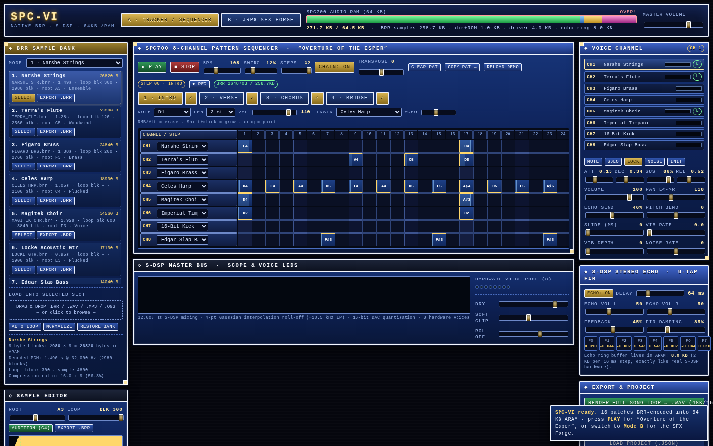
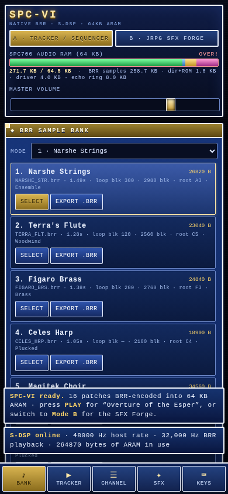
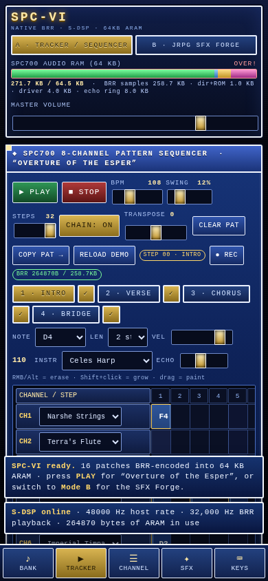
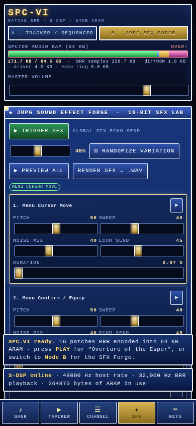
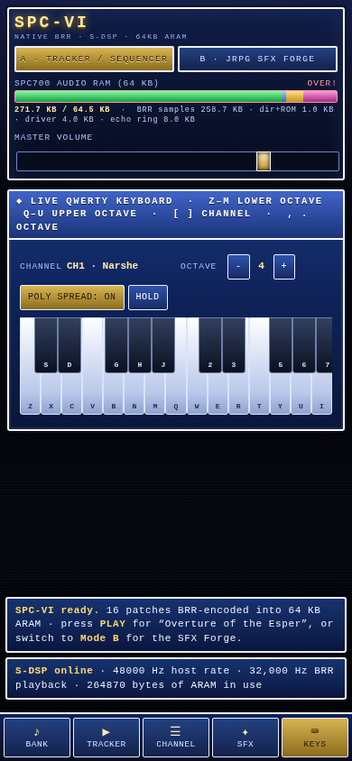

# SPC-VI · SNES BRR Audio Workstation

[](https://webxdc.org)
[](#install)
[](https://developer.mozilla.org/docs/Web/API/Web_Audio_API)
[-9cf)](#license)
[](https://github.com/AETHER-ENGINEERS/Pandora-Dee.s-Atelier-Self-Evolving-AI-Sovereign-IDE/releases)

> **Webxdc mini-app: native BRR codec + 8-voice S-DSP engine + 32-step pattern sequencer + 16 procedural JRPG SFX presets. Runs in Vector, Delta Chat and Pandora Dee's Atelier. Desktop layout on wide screens, fixed bottom tab bar on phones.**

SPC-VI is a self-contained SNES audio workstation that implements the
SPC700's BRR ADPCM codec, a faithful 8-voice S-DSP mixing graph, a 4-pattern
tracker, and a 12-preset JRPG sound-effect forge — all running at the
original 32 kHz S-DSP native rate on top of the Web Audio API. The whole
thing ships as one HTML file wrapped as a [webxdc](https://webxdc.org)
mini-app, so it loads inside Vector chats, Pandora Dee's Atelier, Delta Chat,
or any webxdc-compatible host, with no server and no network calls.

---

## Screenshots

### Desktop — three-column studio layout (1440 × 900)



### Mobile — five-panel tabbed layout (390 × 844, iPhone 12 viewport)

| Bank | Tracker | SFX | Keys |
| --- | --- | --- | --- |
|  |  |  |  |

> Drop the contents of `docs/screenshots/` into your repo at that path, or
> edit the image links above to point wherever you host them.

---

## Features

### BRR sample bank

- **Full BRR codec** — encoder and decoder implement all four official Sony
  prediction filters (0: none, 1: `p₁ + (-p₁ >> 4)`, 2: `2p₁ - p₂` family,
  3: `2p₁ - p₂` higher-order), per-block optimal shift search minimising
  squared quantisation error with a clipping penalty, header E/L flag
  handling for one-shot and looped samples.
- **16 procedural patches** generated at boot, BRR-encoded, then re-decoded
  to verify round-trip fidelity — see the [patch table](#the-16-brr-patches).
- **Drag & drop import** of `.brr`, `.wav`, `.mp3`, `.ogg`, `.flac`, `.m4a`.
  Audio is resampled to 32 kHz, mono-mixed, and re-encoded to native BRR.
- **Auto-loop** — a periodicity search finds a click-free loop point and
  crossfades the tail into the head.
- **Export `.BRR`** for any slot — raw 9-byte blocks ready to drop into an
  SPC700 driver or an emulator's ARAM.

### S-DSP voice engine

- **8 hardware voices** with proper ADSR, per-voice volume / pan / echo send /
  pitch bend / portamento / vibrato / noise rate.
- **Voice stealing** with per-channel lock — oldest unlocked voice is
  reclaimed when all 8 are busy, exactly like real S-DSP behaviour.
- **15-bit LFSR noise generator** using the S-DSP's tap pattern
  (`(r ^ r >> 1) & 1`, 15-bit shift register).
- **Gaussian roll-off low-pass** (~10.5 kHz cutoff) + **12-bit DAC lattice**
  quantisation + optional soft-clip `tanh` waveshaper for the 16-bit crunch.
- **Stereo 8-tap FIR echo** with adjustable delay (16 ms steps, 1–15),
  feedback, per-channel echo volume, FIR damping, and a real echo ring
  buffer that lives in the modelled ARAM (2 KB per 16 ms step).

### Tracker / sequencer

- **4 chainable patterns** (INTRO · VERSE · CHORUS · BRIDGE) × **8 channels**
  × **32 steps** (or 16 with the Steps switch).
- **BPM 60–220**, swing 0–60 %, transpose ±12 semitones.
- **Per-step** note, length (1–16 steps), velocity, instrument override,
  echo send.
- **Live step recording** — play the QWERTY keyboard while the song runs and
  notes snap to the nearest step.
- **Lookahead scheduler** (140 ms lookahead, 25 ms tick) for jitter-free
  timing even under load.
- Ships with the demo song *"Overture of the Esper"* — a 4-minute
  FFVI-flavoured loop.

### JRPG SFX forge

- **12 hand-tuned SFX presets** — see the [SFX table](#the-12-sfx-presets).
- Per-preset **Pitch / Sweep / Noise Mix / Echo Send / Duration** sliders
  with one-tap randomisation for variation takes.
- **Preview All** walks the whole catalogue so you can audition every effect
  in 8 seconds.
- Each SFX is built from the same BRR patches and voice engine, so they're
  authentic 16-bit JRPG sounds, not samples.

### Export

- **Render Full Song Loop → .WAV** (48 000 Hz / 16-bit stereo, 2 loops).
- **Render Current Pattern → .WAV**.
- **Render SFX → .WAV**.
- All renders use an `OfflineAudioContext`, include 16-bit dithered PCM, and
  are written with a hand-rolled WAV encoder (no dependencies).
- **Save / Load Project (.json)** — embeds custom BRR samples as base64 so
  the project is fully self-contained.
- **Export BRR Bank (.json)** — all 16 slots as a portable JSON bank.

### Mobile / touch

- **Fixed bottom tab bar** with five views: **Bank · Tracker · Channel ·
  SFX · Keys**. Only the active panel is shown so each view stays single
  column and scrollable on a phone.
- Touch-sized hit targets: 36 × 36 px step cells, 22 px range-slider thumbs,
  28 px minimum select height, 38 px piano keys.
- The piano keyboard scrolls horizontally and is 108 px tall on touch.
- The 32-step grid scrolls horizontally with a sticky channel-label column.
- iOS double-tap zoom and tap-highlight are suppressed on controls.
- `viewport-fit=cover` is set so iPhone notches and home-indicator insets
  are respected.
- Tapping **SFX** auto-switches Mode A → Mode B (Tracker → SFX Forge);
  Tracker / Bank / Channel switch back to Mode A.
- Landscape phones (`max-height: 520 px`) get a 2-column SFX grid and
  shorter step cells so the tracker still fits.

---

## Install

The `.xdc` file is the canonical artifact. Three ways to use it:

### 1. Vector (mobile or desktop)

[Vector](https://vectorapp.io) is a free, open-source, Nostr-based private
messenger with built-in webxdc support since v0.4.0 "Concord Rising".

1. Open Vector and start or join any chat (1:1 or group).
2. Attach `SPC-VI-SNES-BRR-Workstation.xdc` like any other file and send it.
3. Tap the message — Vector offers to **open** the webxdc. It runs inside
   Vector's sandboxed webview; no internet access is needed.
4. The app persists in the chat, so anyone in the conversation can re-open
   it later. State is local per-device; use **Save Project (.json)** inside
   the app to share your work.

### 2. Pandora Dee's Atelier (PDA SEASIDE)

[PDA SEASIDE](https://github.com/AETHER-ENGINEERS/Pandora-Dee.s-Atelier-Self-Evolving-AI-Sovereign-IDE)
is a self-evolving sovereign IDE / desktop that bridges to Vector and
Discord and can load `.xdc` apps natively.

1. Drop `SPC-VI-SNES-BRR-Workstation.xdc` into the Atelier's app folder, or
   use the **Share to PDA SEASIDE** intent from Vector if both are installed
   on the same device.
2. The Atelier registers it as a Mini App alongside the bundled webxdc apps
   and shows the `icon.png` on its desktop.
3. Click the icon to launch. The Atelier runs the same webview as Vector, so
   the mobile-responsive layout applies automatically.

> **Alternative:** rename the `.xdc` to `.zip`, unzip, and feed the
> resulting `index.html` to the Atelier's "Import a web game" feature.

### 3. Any modern browser (standalone HTML)

```bash
git clone https://github.com/AETHER-ENGINEERS/Pandora-Dee.s-Atelier-Self-Evolving-AI-Sovereign-IDE.git
cd Pandora-Dee.s-Atelier-Self-Evolving-AI-Sovereign-IDE
open SPC-VI-SNES-BRR-Workstation.html
```

Or just double-click the HTML file — no build step, no dependencies, no
server. Audio starts on the first user gesture (browser autoplay policy).

---

## Keyboard & mouse shortcuts

| Action | Shortcut |
| --- | --- |
| **Play / Stop** | `Space` |
| **Lower octave (Z–M row)** | `Z S X D C V G B H N J M , L . ; /` |
| **Upper octave (Q–U row)** | `Q 2 W 3 E R 5 T 6 Y 7 U I 9 O 0 P` |
| **Octave down / up** | `Shift + ,` / `Shift + .` |
| **Cycle keyboard channel** | `[` / `]` |
| **Add note to step** | Left-click on a step cell |
| **Paint notes** | Click + drag across cells |
| **Erase note** | Right-click or `Alt + click` |
| **Grow note length** | `Shift + click` on an existing note |
| **Audition existing note** | Click on a populated cell |

---

## How it works

### BRR codec

BRR (Bit Rate Reduced) is the SNES S-DSP's 4-bit ADPCM format. Every
9-byte block carries a 1-byte header `[ end | loop | filter(2) | shift(4) ]`
and 8 payload bytes encoding 16 4-bit signed nibbles. The decoder adds each
nibble (left-shifted by `shift`) to a prediction computed from the previous
two decoded samples using one of four Sony-defined filters.

The encoder searches, per 16-sample block, all `(filter, shift)` combinations
inside an analytically-seeded shift window and picks the one minimising
squared quantisation error with a small clipping penalty. The decoder state
(`p1`, `p2`) is carried forward exactly as the S-DSP would, so the encoded
stream round-trips bit-perfectly through a real console's decoder.

### S-DSP mixing graph

```
voice → src(BufferSource, loopStart) → ADSR gain
     → Gaussian LP (~10.5 kHz)       → StereoPanner
     → soft-clip WaveShaper (12-bit) → dry bus ─┐
                                       → echo send gain
                                       │
                          echo bus → 8-tap FIR Convolver
                                   → ping-pong delays (16 ms × N)
                                   → feedback cross-mix
                                   → echo vol L / R
                                   └→ master DAC → Analyser → destination
```

All voices mix through the same dry + echo topology, the echo ring buffer
lives in the modelled 64 KB ARAM, and the master bus quantises to a 12-bit
lattice for the authentic 16-bit crunch.

### ARAM budget

The in-app ARAM meter is an authenticity indicator that compares the
total size of the procedurally-generated BRR bank against the real SNES
S-DSP's 64 KB audio RAM budget. The bundled demo bank intentionally exceeds
that budget (~258 KB) so the meter reads "OVER!" in red — this is cosmetic;
the host webview has no such limit and the app keeps working. To stay
inside 64 KB, replace slots with shorter samples or use the Sample Editor
to shorten loops.

---

## The 16 BRR patches

| # | ID | Name | Category | Root | Loop |
| --- | --- | --- | --- | --- | --- |
| 1 | `NARSHE_STR` | Narshe Strings | Ensemble | A3 (57) | yes |
| 2 | `TERRA_FLT` | Terra's Flute | Woodwind | C5 (72) | yes |
| 3 | `FIGARO_BRS` | Figaro Brass | Brass | A2 (53) | yes |
| 4 | `CELES_HRP` | Celes Harp | Plucked | C4 (60) | one-shot |
| 5 | `MAGITEK_CHR` | Magitek Choir | Voice | A2 (53) | yes |
| 6 | `LOCKE_GTR` | Locke Acoustic Guitar | Plucked | E2 (52) | one-shot |
| 7 | `EDGAR_BAS` | Edgar Slap Bass | Bass | C2 (36) | one-shot |
| 8 | `CHOCO_PIZ` | Chocobo Pizzicato | Ensemble | C4 (60) | one-shot |
| 9 | `KEFKA_HPC` | Kefka Harpsichord | Keys | C4 (60) | one-shot |
| 10 | `OPERA_ORG` | Operatic Organ | Keys | C3 (48) | yes |
| 11 | `MYSTIC_CEL` | Mystic Celesta | Bells | C5 (72) | one-shot |
| 12 | `IMP_TIMP` | Imperial Timpani | Percussive | D2 (38) | one-shot |
| 13 | `SNES_SNR` | 16-Bit Snare | Drums | C4 (60) | one-shot |
| 14 | `SNES_KICK` | 16-Bit Kick | Drums | C2 (36) | one-shot |
| 15 | `SNES_HAT` | 16-Bit Hi-Hat | Drums | C5 (72) | one-shot |
| 16 | `DSP_NOISE` | LFSR Wind / Spell | Noise | C4 (60) | yes |

## The 12 SFX presets

| # | ID | Name | Typical use |
| --- | --- | --- | --- |
| 1 | `cursor` | Menu Cursor Move | UI feedback |
| 2 | `confirm` | Menu Confirm / Equip | Accept, equip, OK |
| 3 | `cancel` | Menu Cancel / Error | Back, invalid action |
| 4 | `slash` | Sword Slash & Hit | Melee hit |
| 5 | `fire` | Fire / Fira Spell | Tier-1 fire spell |
| 6 | `ice` | Ice / Blizzara Spell | Tier-1 ice spell |
| 7 | `bolt` | Bolt / Thundaga Spell | Tier-1 lightning spell |
| 8 | `cure` | Cure / Regen Spell | Healing |
| 9 | `chest` | Treasure Chest Open | Reward chime |
| 10 | `airship` | Airship Engine / Takeoff | Vehicle SFX |
| 11 | `boss` | Boss Dissolve / Vanish | Boss intro / phase change |
| 12 | `save` | Save Point Chime | Save / checkpoint |

Each preset exposes **Pitch · Sweep · Noise Mix · Echo Send · Duration**
sliders and a one-tap randomisation button for variation takes.

---

## Repository structure

```
.
├── SPC-VI-SNES-BRR-Workstation.xdc     # installable webxdc (zip)
├── SPC-VI-SNES-BRR-Workstation.html    # standalone HTML, same app
├── manifest.toml                        # webxdc manifest (name, source_code_url)
├── icon.png                             # 256×256 app icon
├── LICENSE                              # AETHER-ENGINEERS Multiversal License
├── README.md                            # this file
└── docs/
    └── screenshots/
        ├── desktop.png
        ├── mobile-bank.png
        ├── mobile-tracker.png
        ├── mobile-sfx.png
        └── mobile-keys.png
```

Inside the `.xdc`:

```
SPC-VI-SNES-BRR-Workstation.xdc          # ZIP with .xdc extension
├── index.html                            # the full workstation (~132 KB)
├── manifest.toml                         # webxdc manifest
└── icon.png                              # 256×256 icon
```

---

## Building from source

There is no build step. The workstation is a single self-contained HTML
file. To regenerate the `.xdc`:

```bash
zip -9 -X SPC-VI-SNES-BRR-Workstation.xdc index.html manifest.toml icon.png
```

Or with Python:

```python
import zipfile
with zipfile.ZipFile('SPC-VI-SNES-BRR-Workstation.xdc', 'w', zipfile.ZIP_DEFLATED, compresslevel=9) as z:
    z.write('index.html')
    z.write('manifest.toml')
    z.write('icon.png')
```

The spec requires ZIP with `Deflate` or `Store` compression and at minimum
an `index.html` at the root. `manifest.toml` and `icon.png` / `icon.jpg`
are optional but recommended. See
<https://webxdc.org/docs/spec/format.html>.

---

## Browser support

Tested on:

- **Desktop:** Chrome / Edge / Firefox / Safari, latest two versions.
- **Android:** Chrome, Vector's webxdc webview.
- **iOS:** Safari, Vector's webxdc webview (audio unlocked on first tap).

Requires Web Audio API with `AudioContext`, `OfflineAudioContext`,
`StereoPannerNode`, `WaveShaperNode`, `ConvolverNode`, `AnalyserNode`. All
supported in any browser from the last 5 years.

---

## Known characteristics & limitations

- **ARAM "OVER!" indicator** — the bundled 16-patch BRR bank (~258 KB)
  deliberately exceeds the real SNES's 64 KB budget. This is cosmetic; the
  host webview has no such limit. Replace slots with shorter samples to
  stay under 64 KB authentically.
- **No persistence between sessions** — edits to the bank / patterns / SFX
  parameters live in memory. Use **Save Project (.json)** to export your
  work, and **Load Project (.json)** to restore it.
- **Exports download via the host browser** — inside Vector's webxdc
  webview they appear in the host's downloads folder; from there they can
  be re-shared as chat attachments.
- **No webxdc `sendUpdate` / shared state** — the app does not sync state
  across chat members. Each participant runs their own instance.

---

## Roadmap

- [ ] Persist project state to `webxdc.sendToChat()` so edits sync across
  chat participants.
- [ ] Add a real `.spc` file exporter (full SPC700 program + ARAM dump).
- [ ] Add IT / XM pattern import for cross-tracker workflow.
- [ ] Add a per-sample BRR visualiser with shift / filter heatmap.

---

## Contributing

PRs welcome. The codebase is one file (`index.html`) split into three
clear sections by `/* === SECTION === */` banners:

1. **Core** — BRR codec, ARAM manager, procedural sample forge, S-DSP
   audio graph, 8-voice engine.
2. **Part 2** — Sequencer / tracker, JRPG SFX forge, UI, import & export.
3. **Mobile layer** (small) — panel switcher, touch sizing, viewport
   detection.

Please keep it dependency-free and single-file — that's the whole point of
shipping as a portable webxdc.

---

## License

This project is licensed under the **AETHER-ENGINEERS Multiversal License**
— the same ANPL-friendly license used across all AETHER-ENGINEERS projects.
It is **not** an OSI-approved license: it grants free use, modification and
distribution, but with conditions including non-malicious use, non-profit
use, no proprietary derivatives, no data mining, and a requirement that the
full license text and the original script header be preserved at the top of
all future builds.

The full text is in [`LICENSE`](LICENSE) and upstream at
<https://github.com/AETHER-ENGINEERS/AETHER-ENGINEERS/blob/main/LICENSE>.

> Always reference the license version with the most recent timestamp from
> either AETHER-ENGINEERS or DarkIlluminatus.

---

## Credits & references

- **webxdc spec & format** — <https://webxdc.org/docs/spec/format.html>
- **Vector** — <https://vectorapp.io>
- **Pandora Dee's Atelier (PDA SEASIDE)** —
  <https://github.com/AETHER-ENGINEERS/Pandora-Dee.s-Atelier-Self-Evolving-AI-Sovereign-IDE>
- **SNES S-DSP / SPC700 hardware reference** — the BRR prediction filters,
  noise LFSR tap pattern, and echo FIR topology are modelled on the
  original Sony S-DSP behaviour documented in the SPC700 Programming
  Manual and the community-maintained
  [SPC Wiki](https://wiki.superfamicom.org/s-smp).
- All patches, SFX, song data and the "Overture of the Esper" demo are
  original procedural work; no copyrighted samples are bundled.
